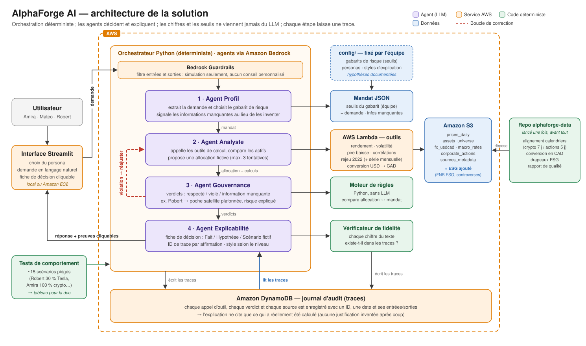

# AlphaForge AI — Datathon PolyFinances 2026

Copilote d'investissement **agentique et auto-explicatif**, en simulation.
L'utilisateur choisit un profil, pose sa question, et voit les agents travailler en direct.
Chaque chiffre de la réponse est relié à une trace de calcul vérifiable.



## Le repo en deux dossiers

| Dossier | Rôle | Se lance |
|---|---|---|
| [`data/`](data/README.md) | Nettoie le jeu de départ, ajoute l'ESG, produit le rapport de qualité, envoie vers S3 | une fois, avant l'app |
| [`app/`](app/README.md) | Agents, outils de calcul, moteur de règles, vérificateur, interface Streamlit | en continu |
| `docs/` | Architecture, décisions, documentation technique, one pager, script vidéo, prototype React | — |

`data/` produit `data/processed/*.csv` (et les dépose dans S3) → `app/` les lit.

## Démarrage rapide (5 minutes, sans AWS)

```bash
cd app
python -m venv .venv && source .venv/bin/activate     # Windows : .venv\Scripts\activate
pip install -r requirements.txt
cp .env.example .env
streamlit run ui/streamlit_app.py
```

## Principes non négociables
1. **Le LLM ne produit aucun chiffre.** Tout calcul est dans `app/src/outils/`.
2. **Les seuils viennent de `app/config/`**, jamais du LLM. Chaque seuil est justifié dans `docs/decisions.md`.
3. **Chaque calcul laisse une trace** (`app/src/traces/journal.py`) et la réponse cite ses traces.
4. **Faits, hypothèses et scénarios fictifs sont toujours distingués.**
5. **Simulation seulement** : aucune transaction réelle, aucun conseil personnalisé.
6. **Aucune clé AWS dans le code ou dans git.**

## Qui fait quoi

| Rôle | Dossiers |
|---|---|
| P1 · Données | `data/` |
| P2 · Calculs et règles | `app/src/outils/`, `app/src/regles/`, `app/config/`, `app/tests/` |
| P3 · Agents | `app/prompts/`, `app/src/agents/`, `app/src/orchestrateur.py`, `app/src/verif/`, `app/src/traces/` |
| P4 · AWS et interface | `app/ui/`, `app/src/bedrock_client.py`, configuration AWS, puis vidéo |

## Travailler à 4 sans se marcher dessus
- Une branche par personne : `donnees`, `calculs`, `agents`, `interface`.
- Petits commits, `git pull` souvent, fusion dans `main` par pull request.
- Avant chaque push : `cd app && pytest tests/`.
