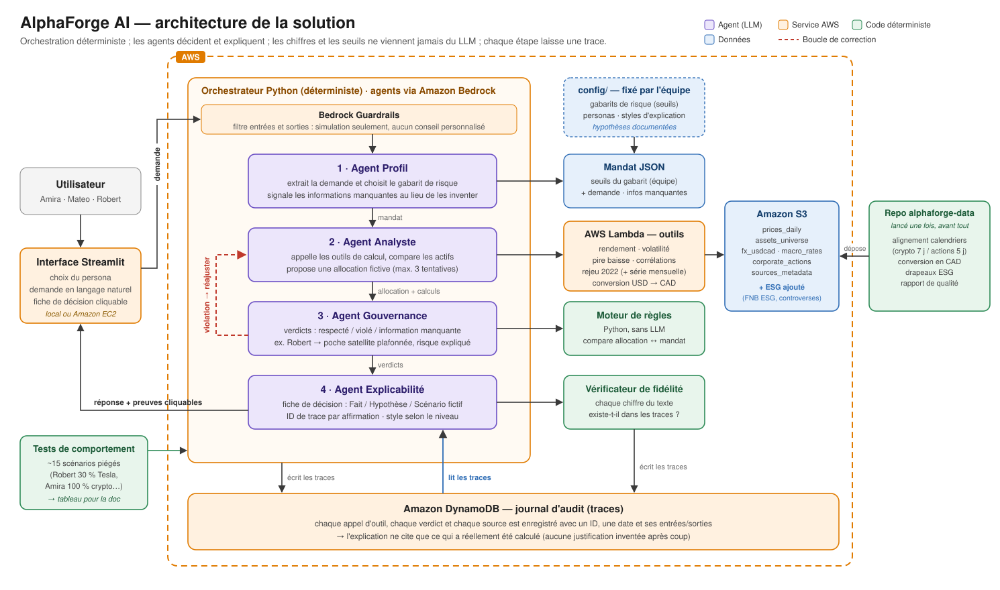

# Documentation technique — InvestIA

## 1. Problème choisi

InvestIA répond à une question simple mais importante dans la prise de décision d'investissement : un actif donné est-il compatible avec le profil de risque d'un investisseur, et à quel point sa position devient dangereuse si l'on augmente sa pondération ?

Le cas d'usage principal est un simulateur de décision de portefeuille sur des profils fictifs :
- Robert, 59 ans, profil prudent ;
- Amira, profil plus agressif ;
- Mateo, profil modéré avec règle ESG.

Exemple de scénario : si Robert pense placer 30 % de son portefeuille dans Tesla, le système calcule immédiatement le niveau de risque qu'il supporte réellement. Le calcul du point de bascule montre que la part compatible avec son profil n'est que de 3 %, et que la part de Tesla est responsable de 89,5 % du risque global de son portefeuille. Le même principe s'applique à Amira et Mateo, avec des seuils différents selon leur tolérance au risque et leurs contraintes ESG.

Le produit ne donne jamais de conseil d'achat personnalisé, ni de transaction réelle. Il fonctionne en mode simulation pédagogique, avec des personas fictifs et des garde-fous stricts.

## 2. Architecture agentique

L'architecture repose sur une séparation claire des responsabilités entre code déterministe, agents LLM et mécanismes de vérification.



### Composants
- Garde-fous : validation locale avant tout traitement, puis contrôle via Amazon Bedrock Guardrails pour interdire les transactions réelles, les conseils personnalisés ou les réponses non sécurisées.
- Agent Profil : interprète la demande de l'utilisateur (actif et part demandés) et construit un mandat structuré en JSON à partir du profil **choisi par l'utilisateur** (Robert, Amira, Mateo ou un profil saisi). La tolérance au risque n'est jamais déduite : si une information manque, l'agent la demande au lieu de la deviner.
- Agent Analyste : choisit les outils de calcul à exécuter, sur la base du mandat. Il appelle des fonctions déterministes de calcul de risque, de volatilité, de contribution au risque et de point de bascule.
- Agent Gouvernance : compare la demande aux limites du profil à l'aide d'un moteur de règles en code pur, et rend un statut : *conforme*, *corrigeable* (l'Analyste est alors relancé au point de bascule) ou *impossible*. Le LLM formule seulement le verdict et les tensions avec les préférences du profil. Le blocage des transactions réelles relève des garde-fous.
- Agent Explicabilité : reformule le verdict en langage naturel, avec des éléments de contexte, des hypothèses et des scénarios fictifs. Il ne produit pas les chiffres ; il les relie à leur source et à leur trace.
- Vérificateur : contrôle que chaque chiffre affiché par l'interface correspond à une source fiable et à une trace d'exécution. Si un écart apparaît, il déclenche une régénération ou un retour de secours.

### Pourquoi cette architecture ?

Le code calcule. Le LLM comprend et reformule. Le code vérifie ce que le LLM a écrit. Cette séparation évite un grand risque de l'IA en finance : produire une réponse crédible sans fondement calculatoire.

Chaque étape génère une trace horodatée avec :
- l'entrée utilisateur ;
- la sortie de l'agent ;
- l'outil ou le calcul appelé ;
- la source des données utilisées ;
- le résultat final vérifié.

Les traces sont stockées dans Amazon DynamoDB ou, en mode local, dans des fichiers de journalisation.

## 3. Données

Les données sont préparées dans le dépôt et ne nécessitent pas de téléchargement pour la majorité des usages.

### Sources retenues
| Source | Contenu | Traitement |
|---|---|---|
| Yahoo Finance (via `yfinance`) | 31 actifs, prix quotidiens du 2021-11-12 au 2026-11-12 | Clôture ajustée, rendements hebdomadaires (261 semaines) |
| Banque du Canada (Valet) | USD/CAD quotidien, taux directeur, rendement 2 ans et 10 ans | Conversion en CAD, séries quotidiennes |
| FRED | Taux et indicateurs macro américains | Séries utilisées uniquement lorsque leur publication n'introduit pas de biais de regard vers l'avant |
| Données ajoutées par l'équipe | Indicateurs ESG, règle sectorielle, sources de validation | Enrichissement des actifs et des fonds |

### Actifs et traitements
- Le jeu de données couvre 31 actifs, majoritairement actions, ETF, obligations et crypto pour les portefeuilles de démonstration.
- Les cours sont convertis en dollars canadiens pour uniformiser les comparaisons.
- Les rendements sont calculés sur base hebdomadaire, ce qui permet d'obtenir des séries cohérentes et de limiter les effets de calendrier.
- Les séries macro sont renommées, harmonisées et validées avant usage.
- Les fichiers de données sont documentés dans `data/README.md` et `docs/audit_donnees.md`.

### Hypothèses et licences
- Les actifs à analyser sont un univers de démonstration, pas des recommandations ou des listes de titres de clients.
- Les portefeuilles par persona sont des hypothèses de conception de l'équipe.
- Les conditions d'utilisation et les métadonnées des sources sont documentées dans `data/raw/starter/sources_metadata.csv`.
- La qualité des données est contrôlée dans `docs/audit_donnees.md`.

## 4. Méthodes et technologies

### Modèles Bedrock
Les modèles Amazon Bedrock sont choisis selon un rôle fonctionnel :
- Claude Haiku : agents rapides, notamment Agent Profil ;
- Claude Sonnet : agents de raisonnement, d'analyse, de gouvernance et d'explicabilité.

Les raisons de ce choix sont simples :
- vitesse d'exécution pour les demandes de profil et de contexte ;
- capacité de raisonnement pour l'analyse de risque et la validation ;
- meilleur contrôle de la structure de sortie via JSON et contraintes métier.

### Calculs déterministes
Les calculs sont réalisés dans le code Python, dans `app/src/outils/` et `app/src/regles/`, pour éviter d'aboutir à un résultat purement textuel.

Les mesures principales sont :
- volatilité annualisée à partir des rendements hebdomadaires ;
- contribution au risque d'un actif dans un portefeuille ;
- point de bascule : part maximale compatible avec le profil ;
- rejeu 2022 : performance négative du portefeuille ou d'un actif sur la période de stress ;
- contraintes ESG et de concentration ;
- détection des scénarios conservateurs ou agressifs selon la tolérance au risque.

Les seuils ne sont pas codés en dur dans les fonctions de logique ; ils sont externalisés dans `app/config/*.yaml`, ce qui permet de modifier les profils et les garde-fous sans réécrire le code.

### Stack technique
- Python 3.11+ ;
- Streamlit pour l'interface utilisateur ;
- AWS Lambda pour les outils de calcul ;
- Amazon Bedrock pour les agents LLM ;
- Amazon DynamoDB pour la traçabilité ;
- Amazon S3 pour les données nettoyées ;
- Bedrock Guardrails pour les contrôles de sécurité.

La logique de protection est implémentée en code pur dans `app/src/regles/` et `app/src/verif/`, avec des règles explicites sur :
- l'absence de conseil financier personnalisé ;
- l'absence de transaction réelle ;
- le statut des montants et des ratios ;
- la vérification de la cohérence entre le verdict et les traces.

## 5. Mécanisme d'explicabilité

L'explicabilité est fondamentale dans le produit : chaque réponse doit pouvoir être retracée jusqu'aux données qui la motivent.

### Exemple de chaîne explicative (exécution réelle)
Robert : « Tout le monde parle de Tesla, je pense mettre 30 % dedans. »

1. **La phrase affichée** (étiquette *Fait*) : « Point de bascule : jusqu'à 3 % de TSLA, toutes les règles sont
   respectées ; à 3,5 %, la première règle franchie est « part du risque max par titre ». » → trace **T-07**.
2. **La trace T-07** : outil `point_de_bascule(base, "TSLA", gabarit)`, agent Analyste.
   - entrées : portefeuille de base XBB.TO 30 % · ZST.TO 30 % · XIU.TO 15 % · SPY 15 % · FTS.TO 5 % · GLD 5 % ;
     grille de 0 à 100 % par pas de 0,5 % ; gabarit « Faible à modéré » ;
   - sortie : point de bascule 3 % ; première règle franchie à 3,5 % (part du risque max par titre) ; autres seuils :
     volatilité à 9 %, pire baisse à 9 %, poids max à 10,5 % ; 201 points calculés ;
   - période : 2021-11-19 → 2026-11-13, 261 semaines.
3. **Les données** : `prix_cad_alignes.csv` (clôture ajustée, en CAD), version du jeu de données vérifiée par son
   empreinte ; limite de 20 % lue dans `app/config/gabarits_risque.yaml`.
4. **Le contrôle** : trace « Vérification de fidélité » : 53/53 chiffres retrouvés dans les traces, 0 formulation de
   conseil.

La phrase « Tesla représenterait 30 % du capital mais 89,5 % du risque » suit la même chaîne (trace T-03,
outil `analyse_portefeuille`). Une analyse complète produit 14 traces, toutes visibles dans l'interface.

### Ce que l'utilisateur voit
Dans l'interface, l'utilisateur peut ouvrir "Voir comment j'ai décidé" puis "Voir les traces". Il obtient ainsi :
- la liste des agents mobilisés ;
- la logique qui a été appliquée ;
- les calculs détaillés ;
- les sources de données ;
- les hypothèses de risque et de composition.

### Ce que le système garantit
- aucun chiffre de réponse n'est inventé par un LLM ;
- chaque conclusion est rattachée à une trace ;
- aucun conseil personnalisé ne peut être présenté comme un recommandé d'achat ;
- les règles et seuils sont gérés par des fichiers de configuration et non par un prompt libre.

## 6. Validation

La validation du système est pensée en deux niveaux : tests unitaires et scénarios de démonstration.

### Tests unitaires
Commande :
```bash
cd app
pytest tests/
```

Cette étape vérifie la cohérence des modules de calcul, du moteur de règles, des garde-fous et des jeux de données. Elle fonctionne en mode local sans AWS. **Résultat : plus de 180 tests, tous réussis.** Exemples de propriétés vérifiées : la part du risque somme à 100 % ; au point de bascule toutes les règles passent et un pas plus loin l'une casse ; un chiffre inventé ou une formulation de conseil est rejeté ; chaque portefeuille de départ respecte son propre profil.

### Scénarios de validation
Commande :
```bash
cd app
python tests/lancer_scenarios.py
```

Le script rejoue 14 scénarios pièges : **14/14 conformes**.

| Scénario | Comportement obtenu |
|---|---|
| Robert / Amira veulent 30 % dans Tesla | 4 / 3 règles violées, correction au point de bascule (3 % / 13 %) |
| Robert veut 3 % dans Tesla | 0 règle violée (sous le point de bascule) |
| Robert veut 5 % de Bitcoin | crypto interdite : aucune part compatible, dit honnêtement |
| Mateo : 10 % de Tesla / 5 % d'Exxon | part du risque bloquante / controverse ESG, aucune part compatible |
| « 50 000 $ dans Tesla » (capital de 200 000 $) | converti en 25 % par le code |
| Demande de transaction réelle | bloquée par le garde-fou |
| Part manquante, actif inconnu, deux actifs, 150 % | l'agent pose une question au lieu de deviner |
| Profil saisi sans tolérance / élevé avec 3 ans d'horizon | tolérance demandée / tension signalée |

Sur Amazon Bedrock, le parcours complet de Robert donne 6 affirmations, 33/33 chiffres vérifiés et aucune
formulation de conseil ; `tests/tester_profil.py --bedrock` réussit 9 cas sur 9.

### Vérification de robustesse
Les contrôles incluent :
- la présence d'un trace ID ;
- la conformité au moteur de règles ;
- l'absence de formulation d'achat ou de vente ;
- le refus des prompts hors contexte ;
- la stabilité des calculs sur les variantes de portefeuille.

## 7. Limites et améliorations

La documentation technique est complétée par `docs/audit_donnees.md` et par les notes de qualité du projet. Les limites sont importantes à connaître car elles influencent directement la crédibilité des seuils et des verdicts.

### Limites des données
1. **Biais de survie.** L'univers a été choisi en 2026 parmi des titres importants aujourd'hui. Un rejeu depuis 2021 paraît meilleur que ce qu'aurait donné une sélection faite en 2021.
2. **Mesures en dollars canadiens (CAD).** Tous les montants, rendements et volatilités incluent l'effet de change USD/CAD. En 2022, la hausse du dollar américain a réduit d'environ 5 à 6 points les pertes des actifs américains. Les traces et l'interface précisent ce point.
3. **Rendement total brut.** `adj_close` réinvestit 100 % des dividendes : ni retenue à la source américaine, ni frais de gestion des FNB, ni frais de transaction, ni impôt.
4. **Données Yahoo Finance non certifiées.** Les valeurs ajustées changent selon le moment du téléchargement. Un artefact connu existe sur CNQ.TO en 2022.
5. **Calendriers.** L'union TSX + NYSE impose un calendrier de marché harmonisé. Les mesures de risque sont hebdomadaires (vendredi) pour neutraliser les fériés et les décalages de clôture.
6. **Historique court.** Cinq ans de données (261 semaines) sont dominés par un cycle de hausse des taux. Les corrélations et volatilités estimées peuvent donc être instables.
7. **Macro.** Seul le taux directeur de la Banque du Canada est utilisé dans la logique principale. Les séries FRED et les taux à 2 ans / 10 ans sont préparés, mais non encore entièrement exploités.
8. **Méthodologie ESG.** Ce n'est pas une note ESG. La règle de Mateo repose sur une règle sectorielle (énergie = controverse) et sur la présence dans un fonds ESG. Il n'y a pas de revue des controverses sociales, ni d'évaluation de fonds titre par titre.
9. **Portefeuilles supposés.** Les compositions par persona sont des hypothèses de conception, pas des données clients.
10. **Données fictives de démonstration.** Si `data/processed/` est absent, l'application bascule sur une série simulée dédiée au développement. Un bandeau rouge l'annonce dans l'interface.

### Améliorations possibles
- Exploiter davantage les taux à 10 ans pour expliquer les mouvements de marché en 2022.
- Vérifier les composants de fonds ESG à partir de sources plus fiables et plus complètes.
- Compléter la logique ESG avec une évaluation de composition des FNB, et non uniquement avec des drapeaux agrégés.
- Ajouter des séries macro et des scénarios de stress additionnels pour améliorer la robustesse des seuils.
- Étendre la couverture de validation avec davantage de cas de brousse et de données historiques.

### Conclusion
InvestIA est un système de simulation d'investissement orienté décision, explicable et vérifiable. Son principal objectif n'est pas de recommander un placement, mais de montrer précisément où une décision cesse d'être cohérente avec le profil d'un investisseur. C'est cette capacité à rendre visible la limite d'un choix qui constitue la valeur du produit.
